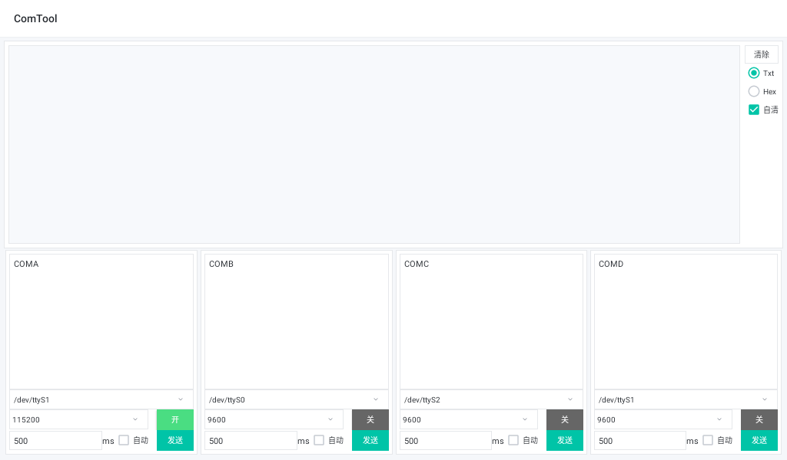

# Android串口通信助手（ComTool）

## 简介

本仓库提供了一个名为“ComTool”的Android串口通信助手源码。该源码可以帮助开发者轻松实现Android设备与串口设备的通信，支持获取设备中可用的串口、波特率，并能够发送十六进制数据和文本数据。该工具特别适用于需要通过Android设备连接读卡器等外设，并获取卡片信息的场景。

## 功能特点

- **获取可用串口**：自动检测设备中可用的串口，方便开发者选择合适的串口进行通信。
- **波特率设置**：支持多种波特率设置，满足不同设备的通信需求。
- **发送数据**：支持发送十六进制数据和文本数据，灵活应对各种通信场景。
- **实际应用**：源码已在实际项目中应用，成功用于Android设备连接读卡器，获取卡片信息。

## 使用说明

1. **导入项目**：将本仓库的源码导入到你的Android开发环境中。
2. **配置串口**：根据实际需求，选择合适的串口和波特率。
3. **发送数据**：使用提供的API发送十六进制或文本数据。
4. **接收数据**：根据需要处理接收到的数据，例如解析卡片信息。

## 注意事项

- 请确保Android设备支持串口通信，并已正确连接外设。
- 在发送数据前，建议先进行串口测试，确保通信正常。

## Android Studio 版本

Android Studio Koala Feature Drop | 2024.1.2 RC 1
Build #AI-241.18034.62.2412.12169539, built on August 1, 2024
Runtime version: 17.0.11+0--11852314 amd64
VM: OpenJDK 64-Bit Server VM by JetBrains s.r.o.
Windows 11.0
GC: G1 Young Generation, G1 Old Generation
Memory: 4068M
Cores: 20
Non-Bundled Plugins:
com.novelreader.plugin (1.0.0)
Statistic (4.3.1)
Dart (241.18808)
io.flutter (85.2.1)

